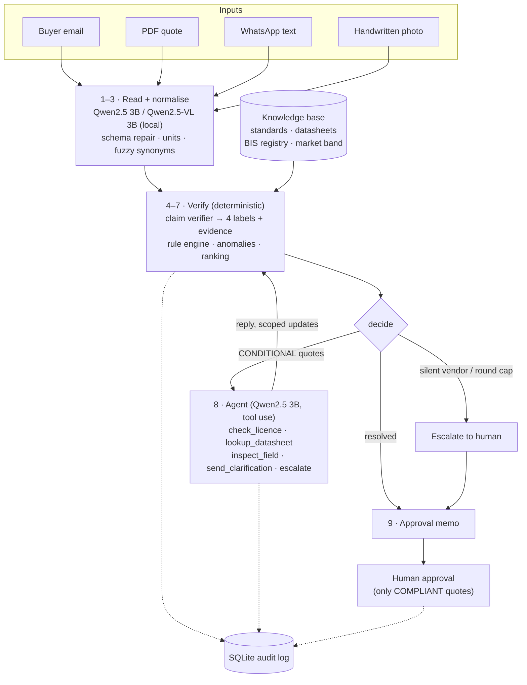

# ProcureIQ

**Autonomous requirement-to-quotation procurement agent.**
*Not the cheapest quote. The cheapest quote that actually meets the spec.*

Project Eclipse · Challenge 04: Procurement

ProcureIQ reads a buyer's request, ingests vendor quotes from messy channels (PDF, WhatsApp text, a handwritten photo), and checks **every vendor claim against evidence before price is considered**. A local AI agent chases missing proof from vendors. A human approves the award; the agent never auto-awards.

Every claim gets exactly one label:

| Label | Meaning |
|---|---|
| ✅ **VERIFIED** | Claim matches evidence in the knowledge base |
| ❔ **UNVERIFIABLE** | No evidence on file, or read with low confidence. Never guessed, never a pass |
| ❌ **CONTRADICTED** | Claim conflicts with a standard, datasheet or registry entry |
| ⚠️ **SUBSTITUTED** | "Or equivalent" wording hides a different material, rating or certification |

**▶ Live demo: [procureiq-v.streamlit.app](https://procureiq-v.streamlit.app/)**, which replays a recorded run of the local Qwen models. Press **Run agent**.

## Quick start (no setup beyond Python)

```bash
git clone https://github.com/itssvs/procureiq && cd procureiq
python -m venv .venv && source .venv/bin/activate      # Windows: .venv\Scripts\activate
pip install -r requirements.txt
streamlit run app.py                                     # press ▶ Run agent
```

With no `.env`, the app replays the **recorded run of the real local model** (Qwen2.5 3B and Qwen2.5-VL 3B), so it works on any machine in seconds. To run the model live, see [Run the local model](#run-the-local-model).

## What happens in the demo

A facilities manager emails a request for 1800 m of 2.5 sq mm copper FR house wire. Three vendors reply:

| Vendor | Channel | Price | What the agent finds | Outcome |
|---|---|---|---|---|
| A · Kaveri Cables | PDF | ₹4.20 L | All 9 spec claims verified against datasheet, BIS registry and FR test values | **COMPLIANT, rank 1** |
| B · Marina Electric | WhatsApp | ₹3.44 L | "Copper **or equivalent**", but its 12.1 Ω/km resistance and the brand datasheet both mean aluminium. No ISI licence; price 12% below the market band | **EXCLUDED** (substituted) |
| C · Anna Nagar Wire | Handwritten photo | ₹4.55 L | Claims FR grade but no test values on file | **CONDITIONAL** |

For C, the agent then works on its own:

1. The model decides to message C for the FR type test report, and writes the request with C's quote reference.
2. C's reply is read by the model. **Only the fields that were asked about** (oxygen index, temperature index, test report number) are accepted.
3. The verifier re-checks C, and C becomes **COMPLIANT, rank 2**.
4. The run stops at **AWAITING_APPROVAL**. The manager sees the recommendation (A), why the 18%-cheaper quote was excluded, and the full evidence trail, then approves in the dashboard.

## Architecture



The orchestration is a **LangGraph** state machine (`procureiq/agent/graph.py`). Every step, model call, vendor message and human decision is written to the audit log.

## Where the AI is, and where it isn't

**The model proposes; deterministic code decides.**

| The local model does | Deterministic code does |
|---|---|
| Reads the buyer email into tagged requirements (mandatory / preferred) | Normalises units and synonyms (pint, rapidfuzz) |
| Reads each quote, including **the handwritten photo through a vision model**, into claims with confidence | Gives every compliance verdict, citing evidence IDs from the knowledge base |
| **Plans the clarification step as a tool-using agent.** It chooses which tools to call and writes each vendor message | Runs the guardrails listed below |
| Reads the vendor's free-text reply | Re-verifies, ranks, and enforces the human approval gate |

The guardrails let a 3B model act safely. Each one was added after watching the real model fail:

- **Only CONDITIONAL vendors can be contacted.** The model once tried to message the excluded vendor, and the tool refused.
- **A reply can only update fields that were asked about.** The model once "extracted" an invented coil count from a reply.
- **Code appends a checklist of every open item** to each vendor message, so nothing is missed.
- **The round ends when every vendor is handled.** The agent is also stopped after two refused calls (the model once looped re-sending), and any vendor it leaves unhandled gets a rule-based message.
- **Model output is repaired, not rejected.** Misfiled keys and filler like "N/A" are fixed or dropped.
- **Numbers are cross-checked.** Totals are reconciled with quantity × rate, and values must fall in plausible ranges. The model once wrote ₹34,400 for "Rs 3,44,000", and the reconciliation corrected it.
- **A regex safety net** catches licence numbers and test values the model drops. Anything it adds is marked `via: rules`.

The dashboard and CLI label every AI step honestly:

| Label | Meaning |
|---|---|
| `ollama:qwen2.5:3b` | Live call |
| `recorded ollama:qwen2.5:3b` | Replay of a real earlier run (committed in `data/cache/`) |
| `seed` | Hand-written placeholder, used only if no model has ever run |
| `rules` | Deterministic fallback |

## Run the local model

```bash
# install Ollama from https://ollama.com/download, then:
ollama pull qwen2.5:3b        # text + agent planning (~2 GB)
ollama pull qwen2.5vl:3b      # reads the handwritten photo (~3 GB)
cp .env.example .env          # LLM_PROVIDER=ollama
python -m procureiq.agent     # full run; prints which model produced each step + the agent's reasoning
```

A full live run takes about 8 minutes on a laptop CPU with no GPU (tested on 20 GB RAM). Setting `PREFER_RECORDED=1` reuses recorded document readings and calls the model only for new steps. Gemini or Groq can be swapped in through `LLM_PROVIDER` in `.env`.

In the dashboard, the **Live model** toggle runs the model now. With the toggle off, the dashboard replays the recorded run instantly.

## Other entry points

```bash
python -m procureiq.ingest              # steps 1–3: requirements + normalised quotes
python -m procureiq.evaluate            # steps 4–7: every claim labelled with evidence, ranked
uvicorn procureiq.api:app --reload      # REST API at http://127.0.0.1:8000/docs
python -m pytest -q                     # 32 tests
```

| Endpoint | Purpose |
|---|---|
| `POST /runs/demo` | Run the built-in scenario |
| `POST /runs` | Run on uploaded files (needs a live model) |
| `GET /runs/{id}`, `/memo`, `/audit` | State, approval memo, audit trail |
| `POST /runs/{id}/approve`, `/reject` | Human decision (409 if the quote isn't COMPLIANT) |

## Dashboard tabs

- **Decision:** the shortlist, a price vs delivery chart, the human approval form, why excluded quotes were excluded (with evidence), and the anomalies.
- **Claim verification:** a requirement × vendor matrix of the four labels, plus the evidence trail behind every claim.
- **Clarifications:** the agent's reasoning (each tool call, thought and result), the message it wrote, the vendor's reply, the fields that changed, and each vendor's status before and after.
- **Quotes:** the original input next to the extracted fields and their confidence bars.
- **Requirements:** the buyer email next to the extracted specs.
- **Audit log:** every step, message and decision.

**Try it yourself** changes a vendor's claim (for example, giving Vendor A an expired licence) and re-runs the real verifier and rules live. No model or recording is involved in that tab.

Switch off **"Vendor C answers clarification"** to watch the agent escalate a silent vendor to a human.

## Ranking and status rules

- **EXCLUDED** if any mandatory requirement is contradicted or substituted.
- **CONDITIONAL** if no mandatory requirement fails but at least one is unverified. The open items list the proof needed.
- **COMPLIANT** if every mandatory requirement passes. Only these quotes are ranked.

The score is 0.6 × price + 0.2 × delivery + 0.2 × warranty, minus a penalty for each unmet preferred requirement. A Pareto flag marks quotes that are non-dominated.

## What's real and what's simulated

| Real | Simulated for the demo |
|---|---|
| Local LLM and vision model reading the documents; the agent's planning and messages | The vendor's reply arrives from a file, not a live email or WhatsApp inbox |
| Claim verification, rules, anomaly detection, ranking, audit log, approval gate | The BIS licence registry, brand datasheets and market prices are **fictional demo data** (the IS 694 / IS 8130 / IS 10810 standard references are real) |
| Parsing of PDF, text and images | Voice notes: the parser reads a cached Whisper transcript |

**Production roadmap:** WhatsApp Business API and email inbox connectors, a live BIS licence lookup, datasheet ingestion that grows the knowledge base, more product categories, and a negotiation round with compliant vendors.

## Repository layout

```
app.py                Streamlit approval dashboard
procureiq/agent/      LangGraph graph, tool-using planner, vendor simulator
procureiq/tools/      parse · extract · normalise · verifier · rules · anomaly
procureiq/llm.py      ollama | gemini | groq | cached, with honest source labels
procureiq/api.py      FastAPI backend          procureiq/audit.py  SQLite audit log
kb/                   standards, datasheets, BIS registry, synonyms
data/demo/            request email, 3 vendor quotes, clarification reply
data/cache/           recorded real model outputs + hand-written seeds
tests/                32 tests, including replay of the recorded model run
```

## Tech stack

LangGraph · Qwen2.5 3B + Qwen2.5-VL 3B via Ollama (local, open-weight) · Gemini / Groq (optional) · pdfplumber, PyMuPDF, Tesseract (optional) · pint, rapidfuzz · pandas · FastAPI · SQLite · Streamlit · Plotly
